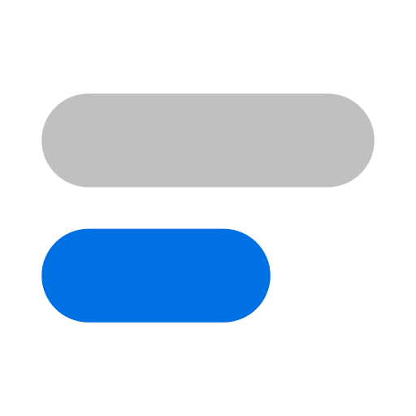
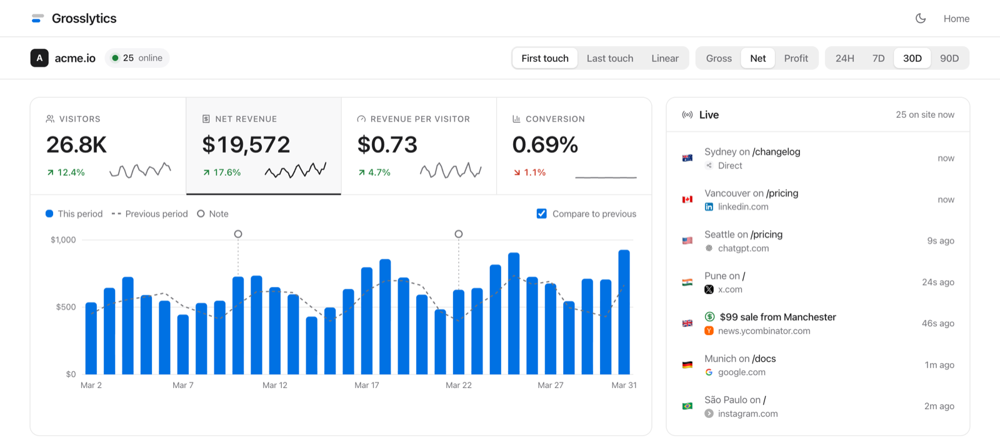
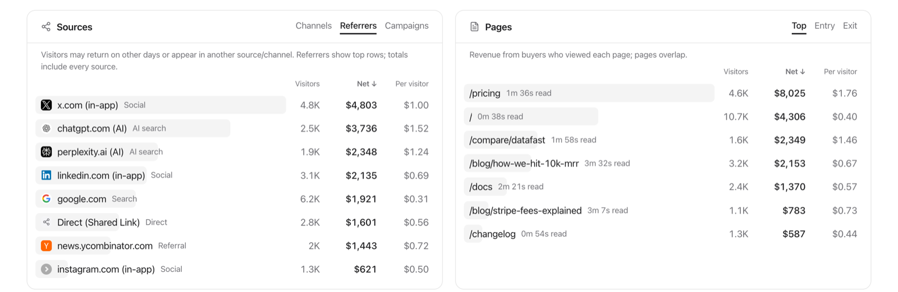
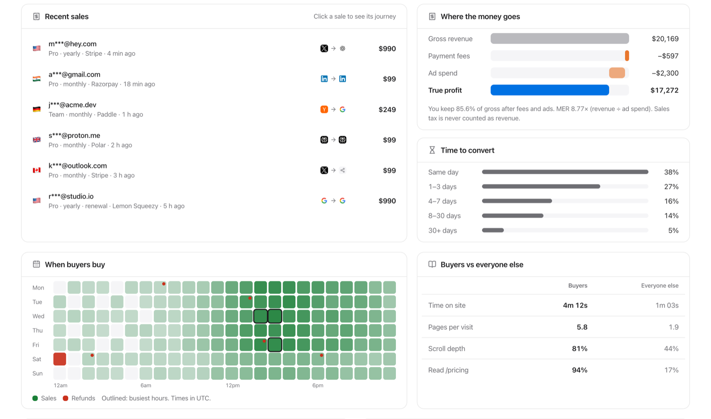

<div align="center">



# Grosslytics

**Revenue analytics that counts what you keep.**

See which posts, searches and AI answers bring paying customers, and what each one earned after payment fees and ad spend. Open source, cookie-free, and it runs entirely in your own Cloudflare account.

[](https://github.com/vidneat/grosslytics/stargazers)
[](LICENSE)
[](https://workers.cloudflare.com/)


[**Live demo**](https://grosslytics.com/app/demo) · [Website](https://grosslytics.com) · [Docs](https://grosslytics.com/docs/) · [Self-host in one command](#self-host-free)

<br>

<a href="https://grosslytics.com/app/demo"></a>

<sub>The live demo at grosslytics.com/app/demo. All numbers in these screenshots are sample data.</sub>

</div>

---

## Why Grosslytics

Most analytics tools tell you how many people visited. Payment dashboards tell you how much you sold. Neither tells you **which channel brought the people who paid**, or what is left after Stripe's cut and your ad bill.

Grosslytics connects the two. A tiny script records visits, your payment provider's webhook records sales, and every sale is credited to the visit that led to it. Then the dashboard ranks your sources, pages and campaigns by **net revenue**, not page views.

- **Know what actually pays.** "X brought 4.8K visitors and $4,803 net, $1.00 per visitor" instead of "X brought 4.8K visitors".
- **Gross, net or profit.** Switch between gross revenue, revenue after payment fees, and true profit after ad spend.
- **First touch, last touch or linear.** Pick the attribution model that fits how your buyers decide.
- **See AI search.** Visits and revenue from ChatGPT, Perplexity, Claude, Gemini and Copilot, plus which AI crawlers read your pages.
- **Unmask "Direct".** In-app browsers (X, LinkedIn, Instagram), shared links and typed visits are told apart instead of all landing in one bucket.
- **Own your data.** It runs on your Cloudflare account: Workers, D1, a Queue and a Durable Object. The free Workers plan is enough for most sites.

## Screenshots

**Every source and page, ranked by the money it brought**



**Each sale with its journey, and where the money goes**



## Features

**Revenue attribution**
- Payment webhooks matched to the exact visitor who paid
- First-touch, last-touch and linear models
- Gross, net (after real gateway fees) and profit (after ad spend) views
- Refunds remove the sale from revenue
- Ad spend per channel, entered by hand or imported from CSV, with ROAS and MER
- Import past Stripe payments

**Traffic and behaviour**
- Sources, channels, referrers and UTM campaigns
- Top, entry and exit pages, with read time and revenue per page
- Countries, cities, devices, browsers and OS
- Live visitors and sales over WebSocket
- Buyer journeys: every page, goal and payment a customer had before paying
- Funnels, goals, scroll depth, time to convert, lifetime value by first source
- "When buyers buy" heatmap, and buyers compared with everyone else
- Optional click map with dead and rage clicks, and which clicks led to sales
- AI crawler reports (GPTBot, ClaudeBot, PerplexityBot and others)

**Built for developers**
- 1.5 KB tracker that sets no cookies
- Sends events with `fetch` to your own domain, so common ad-block lists don't drop them
- REST API with read-only, per-site tokens
- MCP server, so Claude Code, Cursor or Windsurf can answer questions about your numbers
- Public revenue page and an embeddable badge, if you want to share your numbers
- Drop-in for DataFast, DataBull, Plausible and Umami goal attributes and JS calls

## Supported payment providers

| Provider | Matched to the visitor by |
|---|---|
| Stripe | Payment Links and Checkout links are tagged automatically |
| Paddle | `customData.visitor_id` |
| Polar | Checkout links tagged automatically |
| Lemon Squeezy | Checkout links tagged automatically |
| Dodo Payments | Checkout links tagged automatically |
| Razorpay | `notes.visitor_id` |
| Cashfree | `order_tags.visitor_id` |
| Gumroad | Product links tagged automatically |
| PayPal | `purchase_units[].custom_id` |
| RevenueCat | Subscriber attribute `visitor_id` |

Per-provider setup is in the [docs](https://grosslytics.com/docs/).

## How it works

```
Your website ──g.js──▶  /api/event ─┐
                                    ├─▶ Cloudflare Worker ─▶ Queue ─▶ D1 (SQLite)
Stripe, Paddle, … ──▶ /api/webhooks ┘                                    │
                                                                         ▼
                                          Dashboard (/app), API, MCP ◀── queries
```

1. **Add one script tag** to your site's `<head>`:
   ```html
   <script defer src="https://YOUR_HOST/g.js" data-site-id="YOUR_SITE_ID"></script>
   ```
2. **Point your payment webhook** at:
   ```
   https://YOUR_HOST/api/webhooks/{provider}?siteId=YOUR_SITE_ID
   ```
3. **Open the dashboard.** The tracker adds the visitor ID to your checkout links, so each sale is credited to the channel that brought the buyer.

## Self-host (free)

Needs [Bun](https://bun.sh), Node.js 18+, a free Cloudflare account and a domain on it. The free setup asks for one thing back: each site you track carries `<a href="https://grosslytics.com">Powered by Grosslytics</a>` in its footer (a normal link, no `rel="nofollow"`). The dashboard for a site opens once that link is found on its home page, and it is checked daily.

```bash
git clone https://github.com/vidneat/grosslytics.git
cd grosslytics && bun install
bun run setup
```

`bun run setup` asks for a hostname and a dashboard password, signs you in to Cloudflare, creates the database and queues, and deploys everything. Run it again to update. Step-by-step and manual setup: [DEPLOY.md](DEPLOY.md) and [grosslytics.com/docs](https://grosslytics.com/docs/).

### Run it locally

```bash
bun run db:seed:local   # sample site acme.io with 180 days of sample data
bun run dev:api         # API on http://localhost:8787
bun run dev:web         # site and dashboard on http://localhost:4321
```

## Ask your analytics from Claude Code, Cursor or Windsurf

Create a read-only token in `/app` → **API tokens**, then:

```bash
claude mcp add --transport http grosslytics \
  "https://YOUR_HOST/api/mcp?site=YOUR_SITE_ID" \
  --header "Authorization: Bearer gl_pat_…"
```

Then ask things like *"which channel earned the most per visitor this month?"*. Tools: `query_channel_roas`, `inspect_unmasked_direct`, `get_ai_search_citations`, `get_buyer_journeys`, `compare_buyer_reading_time`.

## Pricing

| | Self-host | Indie Cloud | Lifetime |
|---|---|---|---|
| Price | **Free** | **$5.99/month** | **$29 once** |
| Who runs it | You, on your Cloudflare | We do | You, on your Cloudflare |
| Features | Everything, unlimited sites | Everything, up to 100,000 events/month | Everything, unlimited sites |
| Footer link | "Powered by Grosslytics" on your site, required | Not needed | Not needed |
| Extras | Community help on GitHub | 14-day free trial, no card | `npx grosslytics install` without git or Bun, priority email support, commercial license |

[Start Indie Cloud](https://grosslytics.com/start?plan=cloud) · [Get Lifetime](https://grosslytics.com/start?plan=lifetime)

## Tech stack

- **API:** [Hono](https://hono.dev) on Cloudflare Workers, D1, Queues and a Durable Object for live updates
- **Website and dashboard:** [Astro](https://astro.build) with React islands and Tailwind CSS v4
- **Monorepo:** Bun workspaces, Turborepo and Biome

```
apps/edge-api     the Worker: collect, stats, webhooks, MCP
apps/web          marketing site, onboarding and the dashboard
packages/tracker  source for g.js (and the optional click map c.js)
packages/db-d1    queries and migrations
packages/shared   shared types and the dashboard contract
packages/cli      the npx grosslytics installer
```

## Compare

How Grosslytics differs from other tools: [DataFast](https://grosslytics.com/compare/datafast-alternative/) · [DataBull](https://grosslytics.com/compare/databull-alternative/) · [Plausible](https://grosslytics.com/compare/plausible-alternative/) · [Google Analytics](https://grosslytics.com/compare/ga4-alternative/)

## Contributing

Issues and pull requests are welcome. Before opening a PR:

```bash
bun test packages apps
bun run lint
```

Bugs and feature ideas: [open an issue](https://github.com/vidneat/grosslytics/issues). Questions about a paid plan: support@grosslytics.com.

## Support the project

If Grosslytics is useful to you, **[give it a star](https://github.com/vidneat/grosslytics)**. It helps other founders find it.

## License

[AGPL-3.0](LICENSE). Free to use, change and self-host. If you offer a modified version to others over a network, the AGPL asks you to publish your changes, unless you hold a [Lifetime](https://grosslytics.com/start?plan=lifetime) commercial license.
